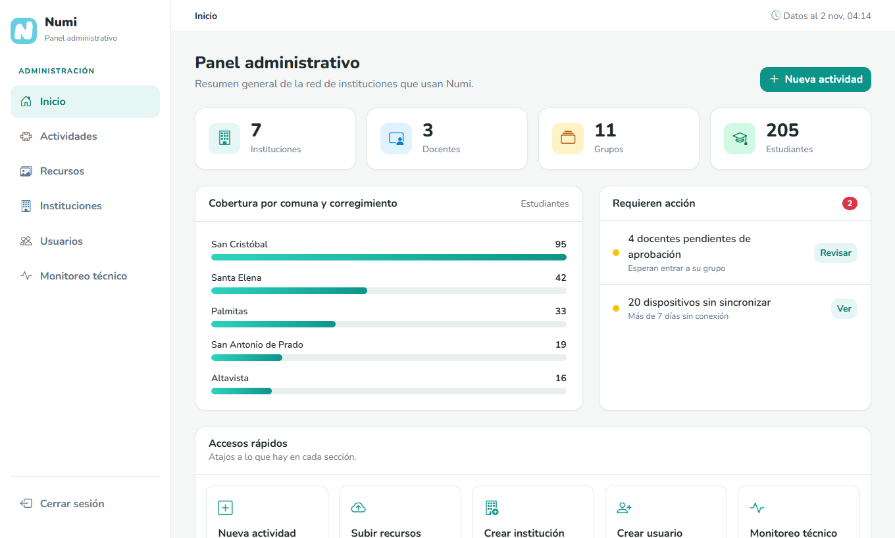
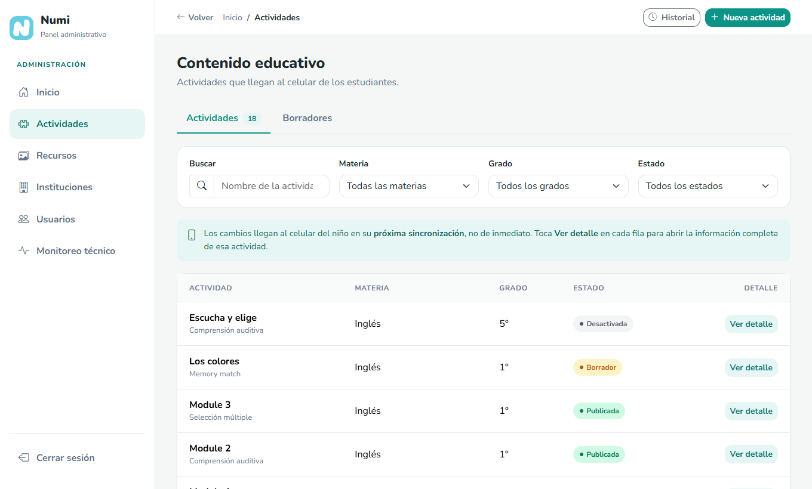
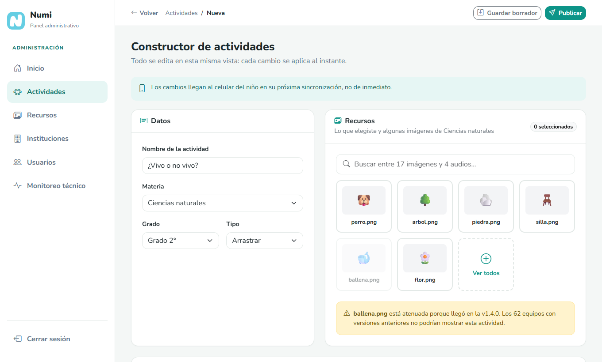
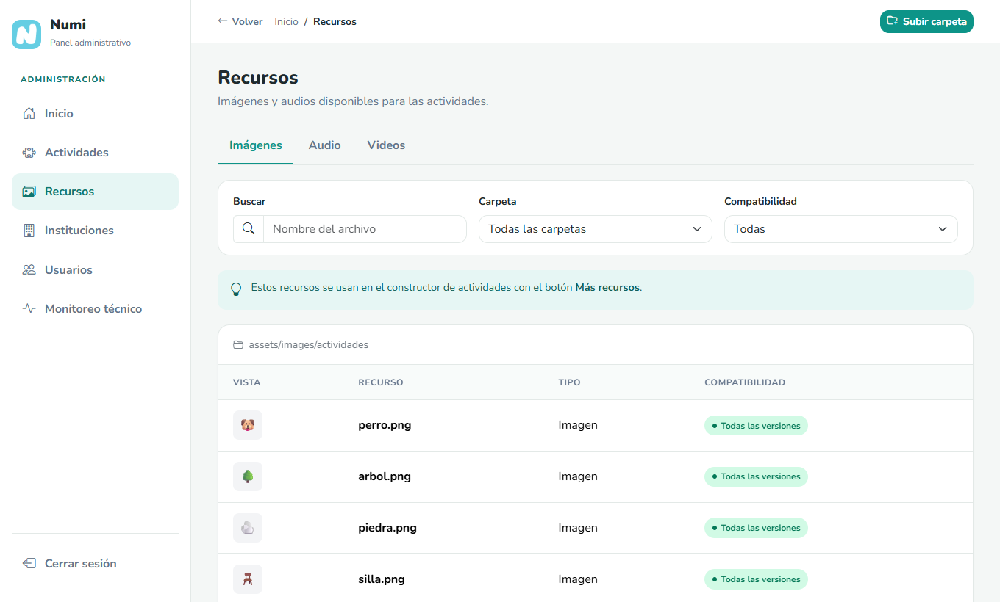
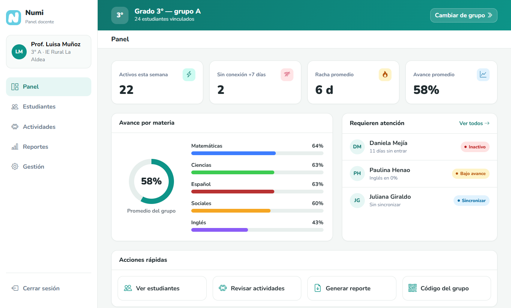
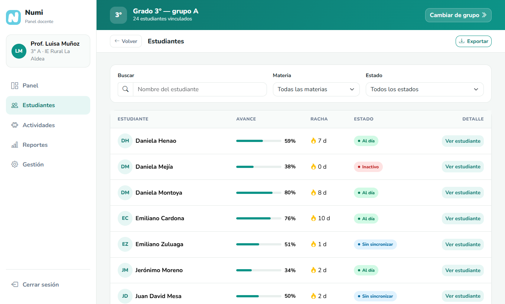
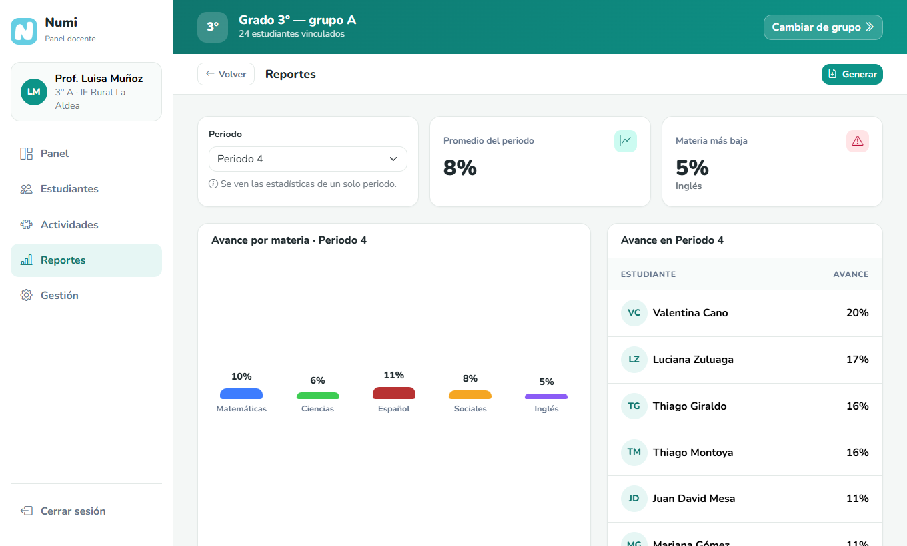
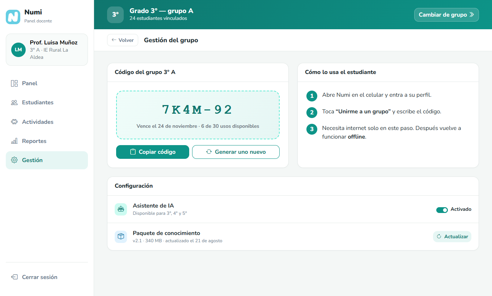

# Numi · Paneles administrativo y docente

Paneles web de **Numi**, la app educativa para niños de 1° a 5° de las instituciones rurales de Medellín
([repositorio de la app](https://github.com/geminitodo5-sketch/app-educativa-medellin)).

- **Panel administrativo** (puerto 5000): actividades y borradores, constructor, recursos, instituciones,
  usuarios y monitoreo técnico.
- **Panel docente** (puerto 5001): avance del grupo, estudiantes, actividades por grupo, reportes en
  Excel/PDF y código del grupo.

## Tecnologías

| Capa | Tecnología |
|------|------------|
| Backend | Python 3 + Flask 3 (un servidor por panel) |
| Base de datos | MySQL 8 con PyMySQL y SQL escrito a mano |
| Front-end | HTML, Bootstrap 5 y JavaScript (`fetch` a la API de Flask) |
| Archivos | openpyxl (Excel) y fpdf2 (PDF) |
| Pruebas | pytest (114 pruebas) |
| Calidad | ruff (`python -m ruff check .`) |

## Cómo funciona

```
Navegador ──► Flask (panel-administrativo, :5000) ──┐
          ──► Flask (panel-docente, :5001) ─────────┼──► MySQL `numi` (una base para los dos)
                                                    │
Backend de la app (FastAPI) ──► /api/app/v1/... ────┘   (puente con la app, con clave)
Panel administrativo ──► APP_API_URL /salud y /api/paquetes (monitoreo)
```

- Cada panel tiene su front-end (HTML, CSS y `js/app.js`). Flask sirve esos archivos y `js/app.js` pide los
  datos a la API (`/api/...`).
- Cada panel protege sus páginas con sesión. "Cerrar sesión" lleva a `index.html`, y abrir esa
  página cierra la sesión.
- La tabla `progreso` tiene la misma forma que el progreso de la app (`grado`, `materia`, `actividad`,
  `porcentaje`, `intentos`, `ultima_vez`) y la misma regla: **gana el mayor avance**.
- Lo que comparten los dos paneles (acceso a MySQL, errores, inicio de sesión, códigos de grupo y el armado
  de cada aplicación) vive en `comun/`.

## Estructura

```
├── comun/                      # código compartido por los dos paneles
├── database/
│   ├── schema.sql              # 16 tablas (las comparten los dos paneles)
│   ├── init_db.py              # crea la base y carga datos de ejemplo (--migrar actualiza una existente)
│   └── importar_recursos_app.py  # trae las imágenes y audios de la app al panel
├── panel-administrativo/
│   ├── *.html, css/, js/, img/ # front-end
│   ├── app.py                  # python app.py → http://localhost:5000
│   ├── servidor_admin/         # auth, inicio, actividades, plantillas, recursos, instituciones, usuarios, monitoreo
│   └── tests/
├── panel-docente/
│   ├── *.html, css/, js/, img/ # front-end
│   ├── app.py                  # python app.py → http://localhost:5001
│   ├── servidor_docente/       # auth, seguimiento, calculos, reportes, gestion, puente_app, archivos
│   └── tests/
├── docs/                       # diseño de cada panel (PDF) y capturas
├── requirements.txt
├── ruff.toml
└── .env.example
```

## Cómo ejecutarlo (Windows / PowerShell)

```powershell
# 1. Entorno virtual y dependencias (desde la raíz del proyecto)
python -m venv .venv
.\.venv\Scripts\Activate.ps1
pip install -r requirements.txt

# 2. Configuración: copia la plantilla y completa tus datos (ver «Configuración» más abajo)
Copy-Item .env.example .env

# 3. Crear la base de datos `numi` con datos de ejemplo
python database/init_db.py              # --reiniciar para borrarla y crearla de nuevo
                                        # --migrar para actualizar una base que ya tenías, sin borrar nada

# 4. Cada panel en su propia terminal
cd panel-administrativo; python app.py  # http://localhost:5000
cd panel-docente;        python app.py  # http://localhost:5001
```

> Abre los paneles con la URL de Flask (`http://localhost:5000`), **no** con Live Server: Live Server
> solo muestra el HTML y no tiene la API, así que los datos no cargan.
>
> En VS Code elige el intérprete del proyecto: `Ctrl+Shift+P` → *Python: Select Interpreter* → `.venv`.

Cuentas de ejemplo (contraseña `Numi2026`):

| Correo | Rol | Panel |
|--------|-----|-------|
| cvelez@medellin.gov.co | Administrador | Administrativo |
| luisa.munoz@ielaaldea.edu.co | Docente (3° A, 4° B y 5° A) | Docente |

## Configuración (`.env`)

| Variable | Para qué sirve |
|----------|----------------|
| `DB_HOST`, `DB_PORT`, `DB_USER`, `DB_PASSWORD`, `DB_NAME` | Conexión a MySQL (la comparten los dos paneles). |
| `ADMIN_SECRET_KEY`, `DOCENTE_SECRET_KEY` | Firman la cookie de sesión de cada panel. |
| `APP_API_URL` | Dirección del backend de la app (por ejemplo `http://127.0.0.1:8000`). El monitoreo comprueba `/salud` y `/api/paquetes`. |
| `APP_API_KEY` | Clave del puente con la app. Tiene que ser **la misma** que `PANEL_API_KEY` en el `.env` del backend de la app; vacía, el puente queda apagado y las actividades no llegan al celular. |

Si cambias el `.env`, reinicia el panel: solo se lee al arrancar.

## Conectar con la app del celular

1. En el backend de la app: `PANEL_API_URL=http://127.0.0.1:5001` y `PANEL_API_KEY` igual a `APP_API_KEY`.
2. El niño entra a un grupo con el código del docente (Configuración → «Unirme a un grupo»).
3. Una actividad publicada llega a los grupos **del grado que se eligió al crearla**; las pantallas que ya trae
   la app valen para todos los grados. El docente puede desactivar cada actividad en su grupo.
4. La app se sincroniza al abrir el menú, al tocar «Volver» y con los botones del menú (no al tocar una actividad).

## Capturas

| | |
|---|---|
|  |  |
|  |  |
|  |  |
|  |  |

## Servicios de la API

**Panel administrativo**

| Pantalla | Endpoints |
|----------|-----------|
| Login / Crear usuario | `POST /api/login`, `POST /api/registro` |
| Inicio | `GET /api/inicio` |
| Actividades, detalle, borradores | `GET /api/actividades`, `GET/PUT/DELETE /api/actividades/<id>` |
| Constructor | `POST /api/actividades` (Publicada o Borrador), `GET /api/recursos` |
| Historial | `GET /api/historial` |
| Recursos | `GET /api/recursos`, `POST /api/recursos` (subir PNG/JPG/MP3/MP4), `GET /uploads/<ruta>` |
| Instituciones | `GET/POST /api/instituciones`, `GET /api/instituciones/<id>`, `POST /api/instituciones/<id>/grupos` |
| Usuarios | `GET/POST /api/usuarios`, `PUT /api/usuarios/<id>`, `PATCH /api/usuarios/<id>/estado`, `POST /api/usuarios/<id>/password-temporal`, `POST /api/usuarios/importar` |
| Monitoreo técnico | `GET /api/monitoreo`, `POST /api/informes`, `GET /api/informes/<id>/descargar` |

**Panel docente**

| Pantalla | Endpoints |
|----------|-----------|
| Login, perfil, Mis datos | `POST /api/login`, `GET /api/me`, `POST /api/grupo-activo` |
| Panel | `GET /api/panel` |
| Estudiantes | `GET /api/estudiantes`, `GET /api/estudiantes/<id>`, `PUT /api/estudiantes/<id>/nota`, `GET /api/estudiantes/exportar`, `GET /api/estudiantes/<id>/informe` |
| Actividades | `GET /api/actividades`, `PATCH /api/actividades/<id>` |
| Reportes | `GET /api/reportes?periodo=`, `GET /api/reportes/descargar` |
| Gestión | `GET /api/gestion`, `POST /api/gestion/codigo`, `PATCH /api/gestion/ia`, `POST /api/gestion/paquete` |

Reportes abre en el periodo que contiene la fecha de hoy; los periodos (cuatro periodos, dos semestres y el
año) están en la tabla `periodos`.

**Puente con la app** (cabecera `X-Api-Key: <APP_API_KEY>`, lo llama el backend de la app, nunca el celular)

| Método | URL | Qué hace |
|--------|-----|----------|
| POST | `/api/app/v1/unirse` | `{uid, nombre, codigo}`: el niño entra al grupo con el código del docente |
| GET | `/api/app/v1/actividades?uid=` | Actividades publicadas y activas para el grupo del niño |
| GET | `/api/app/v1/recursos/<id>` | Archivo de una imagen, audio o video de una actividad |
| PUT | `/api/app/v1/progreso` | `{uid, version_app, racha_dias, items[]}`: mismo formato que `/api/v1/me/progreso` de la app |

## Tipos de actividad que se arman en el panel

El constructor crea actividades de seis tipos. La app las juega con una plantilla de su tipo, sin
programar pantallas nuevas (el formato de cada contenido está en `servidor_admin/plantillas.py`):

| Tipo | El niño... | Contenido |
|------|-----------|-----------|
| Selección múltiple | elige la respuesta correcta | `preguntas` |
| Comprensión auditiva | escucha un audio y elige la respuesta | `preguntas` (cada una con audio) |
| Arrastrar | arrastra cada elemento al grupo al que pertenece | `grupos` + `elementos` |
| Arrastrar y soltar | arrastra cada elemento hasta su pareja | `parejas` |
| Ordenar sílabas | ordena las sílabas de una palabra | `palabras` |
| Memory match | encuentra los pares de cartas | `pares` |

Un borrador puede estar incompleto; para publicar, el contenido se valida completo (por ejemplo, en «Arrastrar»
dos grupos no pueden llamarse igual). Las imágenes y audios se eligen con un buscador que abarca todo el catálogo.

## Usuarios

Desde el panel solo se crean (a mano o importando un archivo) cuentas de **docente**. Las de administrador no se
crean desde el panel y el rol de una cuenta no se puede cambiar.

## Recursos de la app

Las imágenes y audios del constructor son los de la app. `uploads/` no se sube a git, así que en un equipo
nuevo hay que importarlos (se puede repetir sin duplicar):

```powershell
.\.venv\Scripts\python.exe database/importar_recursos_app.py   # lee ~/Documents/app-educativa-medellin/frontend
.\.venv\Scripts\python.exe database/importar_recursos_app.py --app "C:/ruta/a/app-educativa-medellin/frontend"
```

## Pruebas y calidad del código

```powershell
python -m pytest        # desde la raíz: corre las pruebas de los dos paneles
python -m ruff check .  # errores, código sin usar e imports (pip install ruff)
```

Las pruebas usan una base aparte (`numi_test`) que se crea de nuevo en cada archivo de pruebas, así que no tocan
tus datos.

## Documentación de diseño

- [Diseño del panel administrativo](docs/diseno-panel-administrativo.pdf)
- [Diseño del panel docente](docs/diseno-panel-docente.pdf)

## Equipo

Proyecto hecho en equipo como parte de Numi, la aplicación educativa offline para niños de zonas rurales.

| Integrante | Enlaces |
| :-- | :-- |
| **Luis Miguel Muñoz Rendón** | [GitHub](https://github.com/luism7p7) · [Portafolio](https://luism7p7.github.io) |
| **Alexander Mejía Ospina** | [GitHub](https://github.com/AlexanderM-Code) · [Portafolio](https://alexanderm-code.github.io) |
| **Santiago Mayorga Hueso** | [GitHub](https://github.com/qxsantx) |
